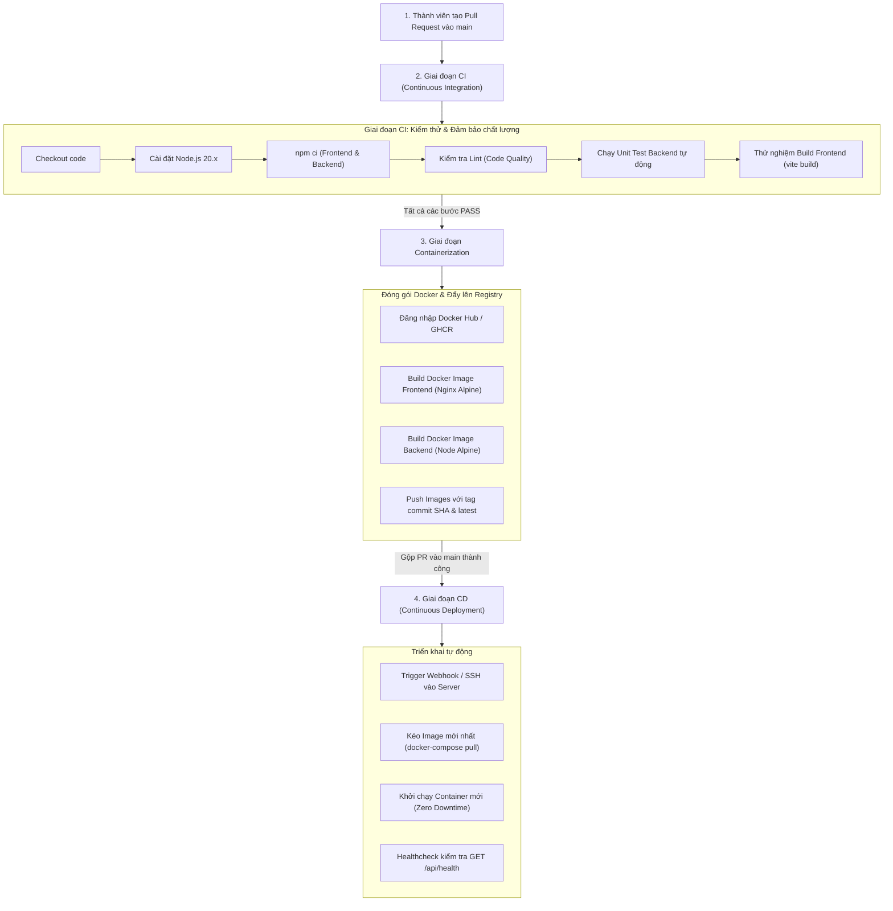

# BÁO CÁO PHÂN CÔNG NHIỆM VỤ CHI TIẾT & THIẾT KẾ CI/CD PIPELINE
## ĐỒ ÁN PHÁT TRIỂN HỆ THỐNG AQUACRAFT (MÔN HỌC DEVOPS)

* **Môn học:** DevOps / Kỹ thuật Phần mềm
* **Mô hình kiến trúc:** Feature-Driven Monorepo (Vertical Slice Architecture)
* **Quy mô:** Nhóm 4 Thành viên

---

## 1. NGUYÊN TẮC PHÂN CHIA (VERTICAL SLICE FULLSTACK)
Dự án được phân chia theo hai nguyên tắc then chốt:
1. **Fullstack theo Tính năng (Vertical Slice):** Mỗi thành viên phụ trách trọn vẹn cả **Frontend (UI, Hooks, API Client)** và **Backend (API, Service, Model, Middleware)** cho module của mình. Không ai phải chờ đợi ai, tự làm API và tự kết nối giao diện.
2. **Chuyên biệt hóa CI/CD (1 người phụ trách duy nhất):** Toàn bộ pipeline tự động hóa CI/CD, viết Dockerfile và docker-compose được giao trọn gói cho **Thành viên 1 (DevOps Lead)**. Ba thành viên còn lại tập trung 100% vào nghiệp vụ tính năng và chỉ cần tuân thủ quy tắc mở Pull Request.

---

## 2. BẢNG MA TRẬN PHÂN CÔNG TỔNG QUAN 4 THÀNH VIÊN

| Thành viên | Tính năng đảm nhận | Khối lượng Frontend (FE) | Khối lượng Backend & DevOps |
| :--- | :--- | :--- | :--- |
| **Thành viên 1** *(Lead & DevOps)* | **Auth, Users & Toàn bộ CI/CD Pipeline** | • Trang Đăng nhập, Đăng ký • Hồ sơ cá nhân (Profile) • Quản trị Users (Admin) • Header Layout & AuthContext | • User Model, JWT, bcrypt • API Login, Register, Profile • Phân quyền Admin • **CHUYÊN TRÁCH 100% CI/CD & DOCKER** |
| **Thành viên 2** | **Products & Catalog (Cá cảnh & Thủy sinh)** | • Danh sách cá & bộ lọc nước ngọt/mặn • Chi tiết cá cảnh, thông số pH • Trang Admin CRUD sản phẩm & upload ảnh | • Product Model • Multer upload hình ảnh • API tìm kiếm, phân trang, lọc giá • API thêm, sửa, xóa sản phẩm |
| **Thành viên 3** | **Cart & Orders (Giỏ hàng & Đơn hàng)** | • Giỏ hàng (CartPage & Drawer) • Form Checkout, địa chỉ nhận hàng • Lịch sử đơn hàng của khách • Admin duyệt đơn & đổi trạng thái | • Cart Model & Order Model • API CRUD giỏ hàng • API Đặt hàng, trừ tồn kho • API cập nhật trạng thái đơn |
| **Thành viên 4** | **Reviews & Dashboard (Đánh giá & Thống kê)** | • Đánh giá sao (1-5★) & form bình luận • Danh sách review dưới chi tiết cá • Admin Dashboard (Cards & Biểu đồ) | • Review Model • API đánh giá kèm điều kiện đã mua • API thống kê tổng doanh thu, đơn hàng, top bán chạy |

---

## 3. THIẾT KẾ CI/CD PIPELINE (DO THÀNH VIÊN 1 CHUYÊN TRÁCH DUY NHẤT)

### Các tệp cấu hình CI/CD Thành viên 1 phải thiết lập:
1. **`.github/workflows/ci-cd.yml`**: Kịch bản tự động hóa trên GitHub Actions cho cả 3 giai đoạn (Lint & Test ➔ Docker Build ➔ Deploy).
2. **`frontend/Dockerfile`**: Multi-stage build (giai đoạn 1 build code Vite bằng Node; giai đoạn 2 chạy Nginx Alpine phục vụ file tĩnh và reverse proxy).
3. **`backend/Dockerfile`**: Đóng gói Node.js Alpine cho REST API.
4. **`docker-compose.yml`**: Cấu hình chạy đồng bộ 3 dịch vụ: Frontend (port 80), Backend (port 5000), MongoDB (port 27017 kèm volume lưu dữ liệu).
5. **Cấu hình GitHub Secrets**: `DOCKER_USERNAME`, `DOCKER_PASSWORD`, `JWT_SECRET`, `MONGO_URI`.

---

## 4. ĐẶC TẢ CHI TIẾT FRONTEND & BACKEND CHO TỪNG BẠN

### 👤 THÀNH VIÊN 1: AUTHENTICATION, USERS & DEVOPS LEAD
* **Backend (BE):**
  * `features/users/user.model.js`: Schema User (`name`, `email` unique, `password` băm `bcryptjs`, `role` 'user'|'admin', `phone`, `address`).
  * `middlewares/auth.middleware.js`: `verifyToken` giải mã JWT Bearer; `verifyAdmin` kiểm tra `role === 'admin'`.
  * `features/auth/auth.routes.js`: `POST /api/auth/register`, `POST /api/auth/login`, `GET /api/auth/me`.
  * `features/users/user.routes.js`: `GET & PUT /api/users/profile`, `GET /api/users` (Admin).
* **Frontend (FE):**
  * `features/auth/services/authApi.js` & `features/users/services/userApi.js`.
  * `features/auth/hooks/useAuth.js`: Quản lý state token, user, hàm `login()`, `logout()`.
  * `LoginPage.jsx` & `RegisterPage.jsx`: Giao diện đăng nhập, đăng ký, validate form.
  * `ProfilePage.jsx`: Xem và sửa địa chỉ nhận hàng, số điện thoại.
  * `AdminUserManagePage.jsx`: Bảng danh sách người dùng cho Admin.
  * `MainLayout.jsx`: Tích hợp hiển thị Tên/Avatar khi đăng nhập, nút Đăng xuất.
* **DevOps & CI/CD:** Toàn quyền phụ trách 100% CI/CD Pipeline và Docker.

---

### 🐟 THÀNH VIÊN 2: PRODUCTS & CATALOG (CÁ CẢNH & THỦY SINH)
* **Backend (BE):**
  * `features/products/product.model.js`: Schema (`name`, `price`, `category`: 'fish'|'plant'|'tank'|'food', `stock`, `images`, `waterType`: 'freshwater'|'saltwater', `isActive`).
  * `middlewares/upload.middleware.js`: Cấu hình Multer nhận file upload ảnh.
  * `features/products/product.routes.js`:
    * `GET /api/products`: Danh sách cá kèm lọc: `?category=&waterType=&search=&minPrice=&maxPrice=&page=`.
    * `GET /api/products/:id`: Chi tiết 1 con cá.
    * `POST /api/products`: (Admin) Thêm sản phẩm kèm upload ảnh.
    * `PUT /api/products/:id`: (Admin) Cập nhật giá, số lượng kho.
    * `DELETE /api/products/:id`: (Admin) Xóa mềm sản phẩm (`isActive = false`).
* **Frontend (FE):**
  * `features/products/services/productApi.js` & `hooks/useProducts.js`.
  * `ProductCard.jsx`: Thẻ hiển thị cá (ảnh, tên, tag Nước ngọt/mặn, giá VND, nút mua).
  * `ProductFilter.jsx`: Bộ lọc loài cá, loại nước, thanh trượt giá.
  * `ProductListPage.jsx`: Grid danh sách sản phẩm, thanh search bar và phân trang.
  * `ProductDetailPage.jsx`: Chi tiết cá, thông số pH/nhiệt độ, chọn số lượng, nút "Thêm vào giỏ".
  * `AdminProductManagePage.jsx`: Bảng quản lý sản phẩm cho Admin.

---

### 🛒 THÀNH VIÊN 3: CART & ORDERS (GIỎ HÀNG & THANH TOÁN)
* **Backend (BE):**
  * `features/cart/cart.model.js` & `features/orders/order.model.js`: Schema giỏ hàng & đơn hàng.
  * `features/cart/cart.routes.js`:
    * `GET /api/cart`: Lấy giỏ hàng, populate chi tiết cá.
    * `POST /api/cart/add`: Thêm hoặc tăng số lượng `{ productId, quantity }`.
    * `DELETE /api/cart/:productId`: Xóa 1 sản phẩm khỏi giỏ.
  * `features/orders/order.routes.js`:
    * `POST /api/orders`: Đặt hàng từ giỏ (Kiểm tra tồn kho `stock`, tính tiền, trừ tồn kho, làm rỗng giỏ).
    * `GET /api/orders/my-orders`: Xem lịch sử đơn hàng của khách.
    * `GET /api/orders/admin`: (Admin) Xem toàn bộ đơn hàng trong hệ thống.
    * `PATCH /api/orders/:id/status`: (Admin) Cập nhật trạng thái đơn (`pending` ➔ `shipping` ➔ `delivered`).
* **Frontend (FE):**
  * `features/cart/services/cartApi.js` & `features/orders/services/orderApi.js`.
  * `features/cart/hooks/useCart.js`: Quản lý state giỏ hàng, badge icon giỏ trên Header.
  * `CartPage.jsx`: Bảng giỏ hàng, nút tăng giảm [+] [-], tạm tính tổng tiền.
  * `CheckoutPage.jsx`: Form nhập địa chỉ nhận hàng, SĐT, chọn thanh toán COD/QR.
  * `OrderHistoryPage.jsx`: Lịch sử đơn hàng của khách kèm tag trạng thái.
  * `AdminOrderManagePage.jsx`: Bảng đơn hàng cho Admin, dropdown đổi trạng thái đơn.

---

### ⭐ THÀNH VIÊN 4: REVIEWS & DASHBOARD (ĐÁNH GIÁ & BÁO CÁO THỐNG KÊ)
* **Backend (BE):**
  * `features/reviews/review.model.js`: Schema Review (`product`, `user`, `rating` 1-5 sao, `comment`).
  * `features/reviews/review.routes.js`:
    * `GET /api/reviews/product/:productId`: Lấy toàn bộ review của 1 con cá.
    * `POST /api/reviews/product/:productId`: Gửi đánh giá sao và nhận xét (Kiểm tra nếu đã từng mua sản phẩm mới cho review).
  * `features/admin/dashboard.routes.js`:
    * `GET /api/admin/dashboard/stats`: Thống kê tổng doanh thu (VNĐ), tổng đơn, tổng khách, tổng cá trong kho.
    * `GET /api/admin/dashboard/recent-orders`: Lấy 5 đơn hàng mới nhất.
    * `GET /api/admin/dashboard/top-products`: Top 5 sản phẩm bán chạy nhất.
* **Frontend (FE):**
  * `features/reviews/services/reviewApi.js` & `features/admin/services/dashboardApi.js`.
  * `StarRating.jsx`: Component hiển thị và chọn sao vàng tương tác (1-5★).
  * `ReviewList.jsx`: Danh sách đánh giá khách hàng đặt dưới chi tiết sản phẩm.
  * `ReviewForm.jsx`: Form gửi nhận xét và chọn số sao.
  * `AdminDashboardPage.jsx`: Màn hình Admin Dashboard với 4 thẻ tổng quan (Doanh thu, Đơn hàng, Sản phẩm, Khách hàng), bảng 5 đơn mới nhất và danh sách bán chạy.

---

## 5. QUY TRÌNH PHỐI HỢP GIT ĐỂ KHÔNG LÀM HỎNG CI/CD
1. **Mỗi người 1 nhánh riêng:** `feature/auth-users`, `feature/products-catalog`, `feature/cart-orders`, `feature/reviews-dashboard`.
2. **Tự chạy kiểm tra cục bộ trước khi push:** Chạy `npm run build` để đảm bảo code không có lỗi cú pháp.
3. **CI Pipeline tự động gác cổng:** Khi mở PR vào `main`, pipeline của Thành viên 1 sẽ tự động kiểm tra Lint và Build. Chỉ khi pipeline báo **Xanh (Pass)** thì Lead mới merge code vào nhánh `main`.
